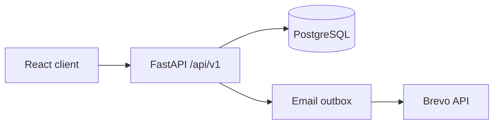

# Architecture

The React/Vite client uses React Query and Axios against the `/api/v1` FastAPI service. FastAPI validates requests with Pydantic, authenticates through HttpOnly signed JWT cookies, and runs workflow logic in services. PostgreSQL is the source of truth. The transactional outbox decouples a committed booking from Brevo delivery.

